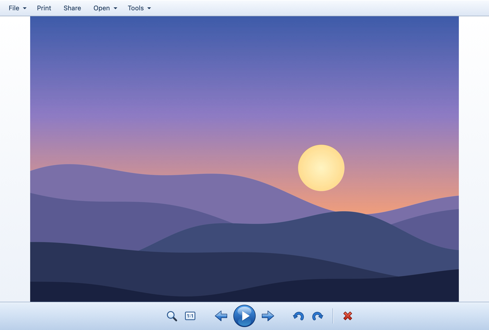
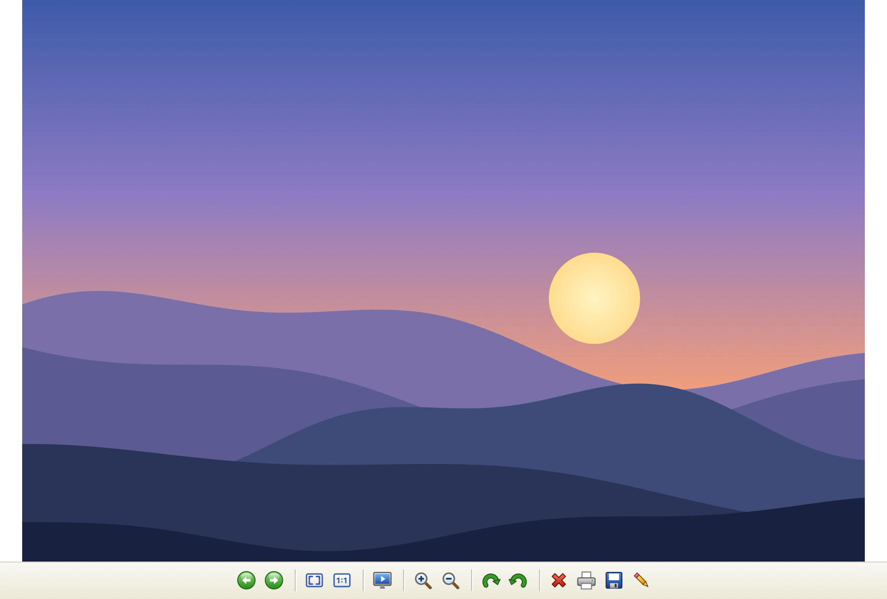
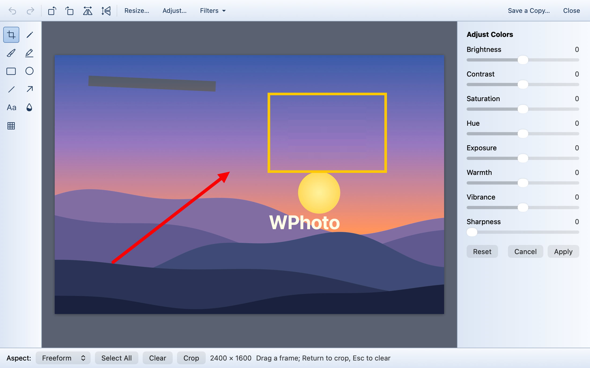

# WPhoto

A Windows-style picture viewer for macOS: open a picture and flip through the whole folder with the
arrow keys. Fast, simple, and it looks like the photo viewer you remember from Windows Vista / 7 —
or from Windows XP, if you prefer.





## Features

- **Arrow keys** (← →, also Page Up / Page Down, Space) go through every picture in the folder,
  sorted by name like Finder; Home / End jump to the first and last. The folder is watched: new and
  deleted files show up on their own.
- **Fast:** pictures are decoded in the background at screen size, the neighbors are prepared
  ahead, the embedded thumbnail shows instantly while a large photo decodes. Full resolution is
  loaded only when you zoom in.
- **Zoom:** mouse wheel (like Windows; can be switched to flipping pictures in View → Mouse Wheel),
  pinch, ⌘+ / ⌘−, the zoom slider, double-click to toggle *Actual size* ↔ *Fit to window*. Drag
  or scroll with the trackpad to move a zoomed picture; swipe sideways to flip pictures.
- **Rotate** (⌘R / ⌘L, Ctrl+. / Ctrl+,): the picture turns right away and the file is updated like
  in Windows — losslessly, only the EXIF orientation changes, pixels are not recompressed.
  Formats that can't store orientation stay rotated on screen only.
- **Delete** moves the file to the Trash (with a confirmation you can turn off); ⌘Z puts it back.
- **Slide show** (⇧⌘F, F5): full screen, crossfade, arrows, Space to pause; right-click for speed,
  shuffle and loop.
- **Editing tools** (Tools menu, ⌘E): crop with aspect presets, resize with or without keeping
  proportions, rotate and flip, pencil, brush and highlighter, rectangle, ellipse, line, arrow and
  text, blur or pixelate an area, color adjustments (brightness, contrast, saturation, hue,
  exposure, warmth, vibrance, sharpness) with live preview, one-click filters (auto enhance,
  black & white, sepia, invert, sharpen, vignette), unlimited undo. See [below](#editing).
- **Save As** another format: JPEG, PNG, HEIC, AVIF, TIFF, BMP, GIF, JPEG 2000 (whatever your macOS
  can write), with a quality slider. Camera data, date and location are kept.
- **File / Print / Share / Open / Tools** bar: make a copy, copy to the clipboard, show in Finder,
  properties with camera data, set as desktop picture, print, share, open with another app.
- **Two themes** (View → Theme): Windows Vista / 7 and Windows XP.
- **One click to make it the default viewer** — see [below](#make-wphoto-your-default-picture-viewer).
- Opens anything macOS can decode, including HEIC, WebP, AVIF and camera RAW.
- English and Russian, following the system language.

## Install

1. Download `wphoto-<version>.dmg` from [Releases](https://github.com/opewix/wphoto/releases).
2. Open it and drag **WPhoto** to **Applications**.
3. The app is not notarized by Apple, so macOS blocks the first launch. Open it once, then go to
   **System Settings → Privacy & Security** and click **Open Anyway**. Or run:

   ```sh
   xattr -dr com.apple.quarantine /Applications/WPhoto.app
   ```

Requires macOS 13 Ventura or later.

## Make WPhoto your default picture viewer

So that double-clicking a picture in Finder opens it in WPhoto:

**The quick way — all formats at once.** Launch WPhoto and choose
**WPhoto → Make WPhoto the Default Viewer** in the menu bar. It sets WPhoto as the default app for
JPEG, PNG, HEIC, GIF, TIFF, BMP, WebP, AVIF, PSD, camera RAW and ICO. If macOS asks to confirm the
change, click **Use "WPhoto"**.

**The Finder way — one format at a time.**

1. In Finder, select a picture (for example a `.jpg`) and press **⌘I** (or right-click → **Get Info**).
2. Under **Open with**, choose **WPhoto**.
3. Click **Change All…** and confirm.
4. Repeat for every other type you use — `.png`, `.heic`, `.gif`…

To go back, do the same and pick **Preview** (or any other app).

## Editing

**Tools → Edit Picture** (⌘E), or any tool from the **Tools** menu, opens the picture in an editor
window. Edits never touch the original: **Save a Copy…** writes a new file (`photo (edited).jpg`
by default) in the format you choose, and the viewer jumps to it.



| In the editor | |
|---|---|
| C · P · B · H | crop · pencil · brush · highlighter |
| R · E · L · A · T | rectangle · ellipse · line · arrow · text |
| U · X | blur area · pixelate area |
| Shift while drawing a shape | square, circle, 45° lines |
| Return · Esc | apply the crop · clear the crop frame |
| ⌘Z · ⇧⌘Z | undo · redo |
| ⌥⌘R · ⌥⌘C | resize · adjust colors |
| ⌘S | save a copy |

## Keyboard

| Keys | Action |
|---|---|
| ← → · Page Up / Page Down · Space | previous / next picture |
| Home / End (⌘↑ / ⌘↓) | first / last picture |
| + / − (⌘= / ⌘−) | zoom in / out |
| 0 (⌘0) · 1 (⌥⌘0) | fit to window · actual size |
| ↑ ↓ | move a zoomed picture, otherwise previous / next |
| ⌘R / ⌘L | rotate clockwise / counterclockwise |
| Delete (⌘⌫) · ⌘Z | move to Trash · undo |
| ⇧⌘F, F5 · Esc | slide show · exit slide show or full screen |
| ⌘E | edit picture |
| ⌘C · ⌘S · ⇧⌘S | copy · save as another format · duplicate the file |
| ⌘I · ⇧⌘R · ⌘P | properties · show in Finder · print |

## Build from source

Only the Swift toolchain is needed (Xcode Command Line Tools), no Xcode project.

```sh
swift build                                        # debug build
./scripts/bundle.sh                                # build/WPhoto.app
VERSION=0.1 ./scripts/make-dmg.sh                  # build/wphoto-0.1.dmg
.build/debug/WPhoto -snapshot reference photo.jpg  # re-render the screenshots (add -theme xp)
```

## License

[MIT](LICENSE). Free to use, modify and distribute; provided as is, without any warranty.

## Disclaimer

WPhoto is an independent project, not affiliated with or endorsed by Microsoft. Windows is a
trademark of Microsoft Corporation. The app ships no Microsoft code, icons or fonts: all graphics
are drawn by the app itself.
